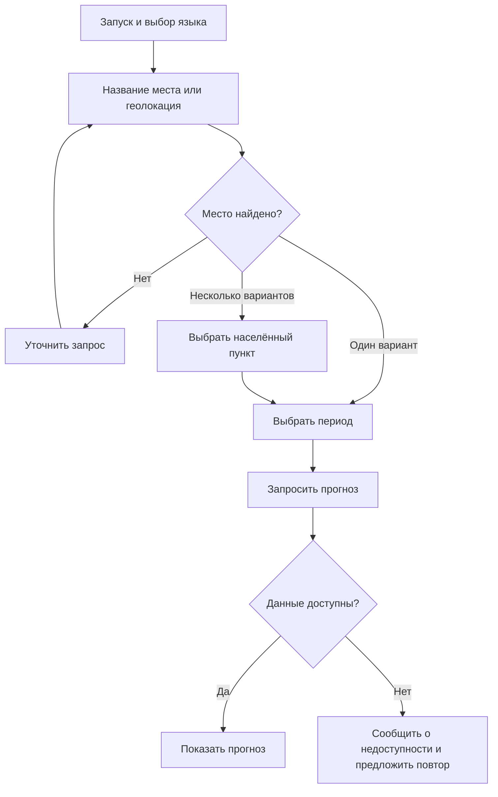

# Анализ требований и сценариев

<br clear="all">

## Погодный бот: от запроса к понятному диалогу

В учебном проекте я разбивал запрос на шаги: запуск и выбор языка, ввод названия места или передача геолокации, уточнение неоднозначного названия, выбор периода и выдача прогноза. В этом кейсе показываю пользовательский сценарий получения внешних данных и локальный пример логики диалога на Python.

### Применённые навыки

| Навык аналитика | Как я его применил |
|---|---|
| Анализ потребности | Определил, какие параметры нужны для ответа на запрос о погоде |
| Декомпозиция | Разделил выбор места и периода на самостоятельные шаги |
| Интерфейс и внешние данные | Разобрал путь от выбора языка и способа указать место до запроса прогноза |
| Описание состояний | Показал, от чего зависит следующий шаг диалога |
| Работа с неоднозначностью | Предусмотрел выбор среди населённых пунктов с одинаковым названием |
| Подготовка требований и проверок | Описал ожидаемое поведение при пустом запросе, неизвестном месте и неверном периоде |
| Пример формализации на Python | Выразил логику диалога через учебный автомат состояний |

### Сценарий



В сценарии разделяю основной путь и обработку ошибок. Для пустого запроса, неверного периода и недоступности сервиса описываю ожидаемое поведение; локальный пример кода показывает выбор места и периода.

### Пример кода и критерии проверки

```python
from dialog_example import Dialog

dialog = Dialog()
print(dialog.handle("Киров"))  # предложить два варианта
print(dialog.handle("1"))      # выбрать место
print(dialog.handle("сегодня"))  # подготовить параметры запроса
```

В [dialog_example.py](dialog_example.py) показываю учебный пример диалога: поиск по локальному справочнику, уточнение места и выбор периода. Пример подготавливает параметры запроса без подключения к погодному API. Запуск: `python dialog_example.py`.

| Проверка | Ожидаемое поведение в демонстрации |
|---|---|
| Пустой ввод | Повторить просьбу указать место |
| Неизвестное место | Попросить уточнить название |
| Несколько совпадений | Показать варианты и запросить номер |
| Неверный номер | Сохранить список и повторить запрос выбора |
| Неверный период | Предложить доступные периоды |
| Место и период выбраны | Подготовить параметры запроса |

### Для каких аналитических задач это полезно

Описание пользовательских сценариев, перевод потребности в требования, поиск пропущенных веток и подготовка критериев приёмки. Так можно согласовать поведение функции до разработки.

### Границы примера

В этом кейсе рассматриваю требования, переходы между состояниями и критерии проверки диалога. Получение реального прогноза, интеграция с погодным сервисом и проверка сетевых ошибок выходят за рамки локального примера.

---

[← Все проекты](https://github.com/antonyakovlev11)
