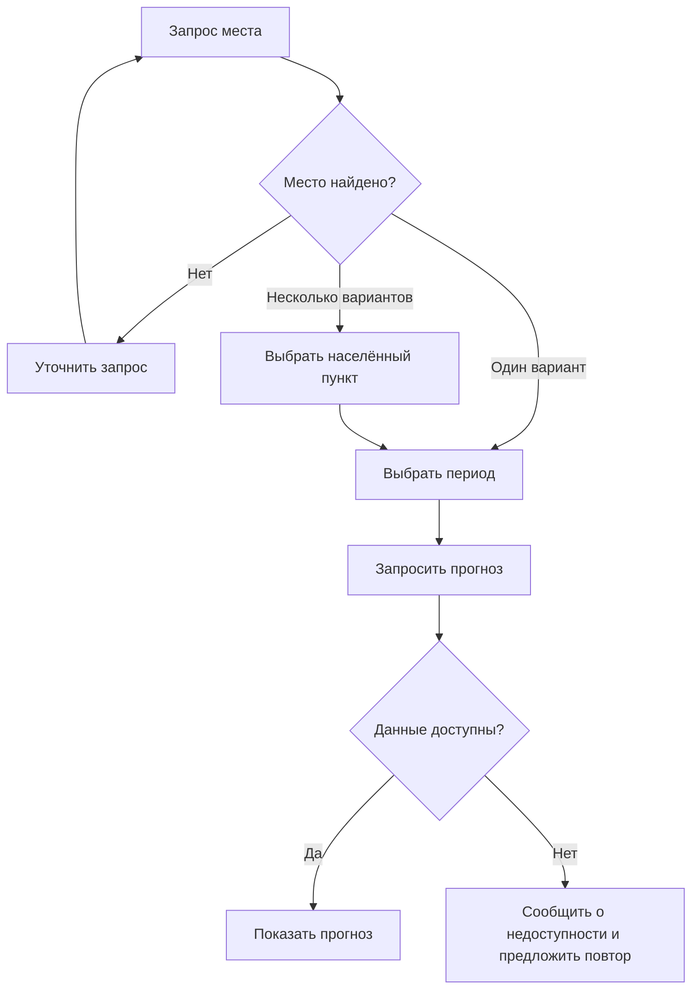

## Погодный бот: от запроса к понятному диалогу

В учебном проекте я разбивал запрос на шаги: выбор места, уточнение неоднозначного названия, выбор периода и выдача прогноза. В этом кейсе показываю логику сценария и пример того, как её можно выразить в коде.

### Применённые навыки

| Навык аналитика | Как я его применил |
|---|---|
| Анализ потребности | Определил, какие параметры нужны для ответа на запрос о погоде |
| Декомпозиция | Разделил выбор места и периода на самостоятельные шаги |
| Описание состояний | Показал, от чего зависит следующий шаг диалога |
| Работа с неоднозначностью | Предусмотрел выбор среди населённых пунктов с одинаковым названием |
| Подготовка требований и проверок | Описал ожидаемое поведение при пустом запросе, неизвестном месте и неверном периоде |
| Пример формализации на Python | Добавил учебный автомат состояний без подключения к погодному API |

### Сценарий



Основной путь опирается на описание исходного проекта. Проверки пустого запроса, неверного периода и недоступности сервиса я добавил как уточнение требований при подготовке портфолио; их реализацию в исходном боте пока не подтверждаю.

### Пример кода и критерии проверки

```python
from dialog_example import Dialog

dialog = Dialog()
print(dialog.handle("Киров"))  # предложить два варианта
print(dialog.handle("1"))      # выбрать место
print(dialog.handle("сегодня"))  # подготовить параметры запроса
```

[dialog_example.py](dialog_example.py) — новая учебная демонстрация логики: поиск по небольшому справочнику, выбор варианта и периода. Она не запрашивает реальную погоду и не заменяет исходный бот. Запуск: `python dialog_example.py`.

| Проверка | Ожидаемое поведение в демонстрации |
|---|---|
| Пустой ввод | Повторить просьбу указать место |
| Неизвестное место | Попросить уточнить название |
| Несколько совпадений | Показать варианты и запросить номер |
| Неверный номер | Сохранить список и повторить запрос выбора |
| Неверный период | Предложить доступные периоды |
| Место и период выбраны | Подготовить параметры запроса |

### Для каких аналитических задач это полезно

Описание пользовательских сценариев, перевод потребности в требования, поиск пропущенных веток и подготовка критериев приёмки. Так можно согласовать поведение функции до разработки.

### Что пока не восстановлено

Исходный код и собственные скриншоты бота пока не найдены. Поэтому здесь нет утверждений о его стеке, погодном сервисе и фактически реализованных ошибках. Следующие шаги — восстановить исходники, подтвердить интеграцию и добавить реальные примеры ответа.

---

[← Все проекты](https://github.com/antonyakovlev11)
