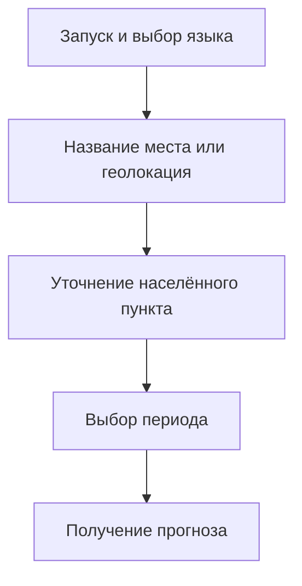

## Учебный погодный бот

**Основной навык:** я разбивал запрос пользователя на последовательные шаги — от выбора места до получения прогноза.

### Задача и контекст
В учебном проекте я делал погодного бота. Я хотел, чтобы пользователь мог получить прогноз через понятный диалог: выбрать место, уточнить период и посмотреть результат.

### Пользовательский сценарий

### Что я сделал
| Навык | Как проявляется в сценарии |
|---|---|
| Декомпозиция запроса | Место и период выбираются отдельными шагами |
| Логика диалога | Следующий шаг зависит от предыдущего выбора |
| Уточнение неоднозначности | Пользователь выбирает нужный населённый пункт |
| Представление данных | Прогноз выдаётся в контексте выбранного места и периода |

### Что сохранилось
Сейчас у меня сохранилось описание проекта. Скриншот, который я использовал при сборке портфолио, относился к похожему боту, поэтому здесь я показываю сценарий схемой.

Исходный код и свои скриншоты я пока не нашёл. Без них не уточняю стек, погодный сервис и реализованную обработку ошибок.

### Что можно добавить после восстановления исходников
После восстановления кода я добавлю свои скриншоты, источник прогноза и инструкцию запуска. Отдельно хочу проверить, что происходит при неизвестном месте, неоднозначном названии и недоступности данных. Пока это план доработки.

---

[← Все кейсы](https://github.com/antonyakovlev11)
